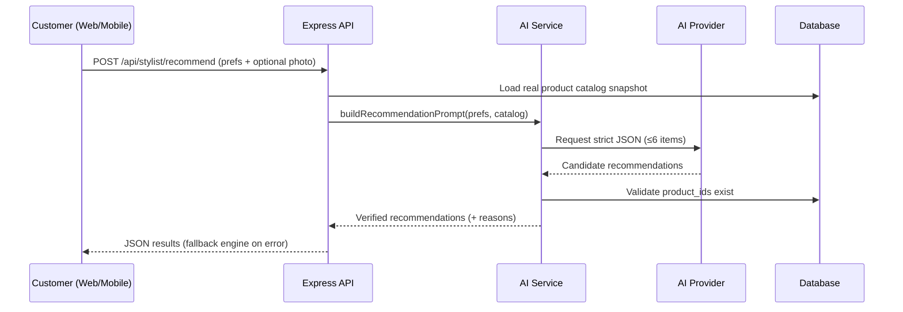

# ElegAI — Project Documentation

## 1. Document Information

| Field | Value |
|---|---|
| Project | ElegAI — AI-Powered Bridal & Formal-Wear E-Commerce Platform |
| Date | October 17, 2026 |
| Version | 1.0 |
| Prepared by | ElegAI Development Team |
| Status | Active / Delivered (MVP) |
| Repository | `github.com/grtxepp/ElegAI_Finale` |

---

## 2. Meetings Log

| # | Date | Attendees | Agenda | Decisions / Action Items |
|---|---|---|---|---|
| 1 | 2026-09-05 | Team, Adviser | Project kick-off, scope definition | Choose bridal & formal-wear niche; confirm MVP scope (no real payments) |
| 2 | 2026-09-12 | Team | Requirements, target users, feature list | Finalize customer + admin feature sets; select tech stack |
| 3 | 2026-09-19 | Team | System architecture & database design | Approve layered architecture (routes → controllers → repositories); schema draft |
| 4 | 2026-09-26 | Team | AI feature design | AI Stylist with reasoned recommendations; body-positive rules |
| 5 | 2026-10-03 | Team | Security review | Add Turnstile CAPTCHA, rate limiting, JWT hardening |
| 6 | 2026-10-10 | Team | AI provider strategy | Adopt free-first provider ladder; add image generation fallbacks |
| 7 | 2026-10-17 | Team | Deployment & documentation | Deploy via Back4app Containers; finalize docs |

> Replace or extend the entries above with your actual meeting records.

---

## 3. Problem

Bridal and formal-wear shopping has real friction on both sides of the market:

1. **Overwhelming choice** — Customers face hundreds of gowns, suits, barongs, and
   accessories and struggle to filter down to items that match their occasion, style,
   color, fit, and budget.
2. **No guidance online** — Traditional e-commerce returns a flat list of products with
   no explanation of *why* an item suits the buyer. Physical boutiques provide a stylist;
   online stores usually do not.
3. **Fit and body sensitivity** — Sizing and fit are critical for formal wear, yet online
   tools rarely account for measurements — and must do so without commenting on the
   customer's body.
4. **Occasion-specific needs** — Weddings, debuts, graduations, and corporate events each
   demand different formality levels that generic filters do not capture.
5. **Boutique operations** — Small boutiques lack affordable tooling to manage inventory,
   orders, and customers online.

**Goal:** build an affordable, AI-assisted online formal-wear platform that guides
customers to the right products with clear reasons, while giving the boutique a full
management console.

---

## 4. Proposed Solutions

| Problem | Proposed Solution |
|---|---|
| Overwhelming choice | **AI Stylist chatbot** that narrows the catalog through conversation |
| No guidance | **AI recommendations with explicit reasons** ("matches your Elegant style", "fits your A-Line preference") |
| Hard to visualize | **Outfit image generation** so customers can preview a look |
| Fit concerns | **Measurement + preference profile** feeding the recommendation engine (body-positive rules) |
| Occasion needs | **Occasion-aware filtering** (Wedding, Debut, Corporate, etc.) |
| Boutique operations | **Admin console**: products, inventory, orders, customers, dashboard |
| Reach | **PWA + native React Native app** for the same backend |
| Trust & abuse | **JWT auth, bcrypt, CAPTCHA, rate limiting, Helmet, CORS** |

**Core solution — the AI Stylist:** the customer describes what they need (or uploads an
optional photo). The backend sends the preferences plus a live snapshot of the real
catalog to an LLM, which returns a strict JSON list of up to **6 real catalog products
with reasons**. Every recommendation is validated against the database, and the system
degrades gracefully to a deterministic rule-based engine if no AI provider is available.

---

## 5. Architecture & Diagram

ElegAI is a **layered monolith** — one small deployable application, not a fleet of
microservices. Responsibilities are separated so UI, API logic, and persistence can
change independently.

```text
┌───────────────────────────────────────────────────────────────┐
│                          Clients                               │
│   React Web (Vite)   │   PWA (installable)   │   Expo mobile    │
└──────────────────────────────┬────────────────────────────────┘
                               │ HTTPS · Axios · JWT Bearer
                               ▼
┌───────────────────────────────────────────────────────────────┐
│                    Express REST API (/api)                     │
│  ┌─────────┐  ┌──────────────┐  ┌───────────┐  ┌───────────┐  │
│  │ Middleware│ │ Controllers  │  │ Services  │  │ Utils     │  │
│  │ auth·cors │ │ validate +   │  │ AI + rec. │  │ errors·   │  │
│  │ captcha·  │ │ shape HTTP   │  │ engine    │  │ tokens·   │  │
│  │ limits    │ │              │  │           │  │ validators│  │
│  └─────────┘  └──────┬───────┘  └─────┬─────┘  └───────────┘  │
│                      │                │                        │
│                      ▼                ▼                        │
│              ┌───────────────┐   ┌──────────────────────────┐  │
│              │ Repositories  │   │ AI Providers (fallback)  │  │
│              │ SQL per       │   │ Gemini → OpenAI →        │  │
│              │ feature       │   │ Pollinations → Stable    │  │
│              └──────┬────────┘   │ Horde → local engine     │  │
│                     │            └──────────────────────────┘  │
└─────────────────────┼──────────────────────────────────────────┘
                      ▼
              TiDB Cloud Serverless (MySQL-compatible)
```

**Request flow (example — AI recommendation):**



**Layer rules**
- Frontend **never** touches the database and holds **no** secrets.
- `routes/` declare endpoints · `controllers/` handle HTTP · `repositories/` own SQL ·
  `services/` hold cross-cutting logic (AI, recommendations).
- API keys (Gemini/OpenAI/Pollinations/Horde), `JWT_SECRET`, and the Turnstile secret
  live **only** in backend environment variables.

---

## 6. Tech Stack

| Layer | Technology |
|---|---|
| Frontend | React 18, Vite, Tailwind CSS, React Router, Axios, Lucide icons |
| Backend | Node.js (≥18), Express 4, REST API |
| Database | TiDB Cloud Serverless (MySQL-compatible); MySQL/MariaDB locally (`mysql2`) |
| Auth | JWT (`jsonwebtoken`), bcrypt (`bcryptjs`) |
| Security | Helmet, CORS, `express-rate-limit`, Cloudflare Turnstile CAPTCHA |
| AI — text | Google Gemini API (primary), OpenAI API (fallback) |
| AI — images | Gemini image → OpenAI `gpt-image` → Pollinations (Flux) → Stable Horde |
| Uploads | Multer (MIME + size validated) |
| Mobile | React Native + Expo (`mobile/`); installable PWA |
| Container | Single Dockerfile (Vite build + Express runtime, `SERVE_FRONTEND=true`) |
| Hosting | Back4app Containers (free tier) |
| Tooling | Git/GitHub, npm |

---

## 7. Advantages and Disadvantages

### Advantages
- **Guided discovery** — recommendations come with reasons, not just a product grid.
- **Real, validated results** — every suggested item exists in the actual catalog.
- **Never breaks** — provider fallback chain + offline rule-based engine keep it working
  with zero API keys.
- **Free-first AI** — free image providers (Pollinations, Stable Horde) reduce cost.
- **Body-positive by design** — hard rule: never comment on the customer's body.
- **Full-stack completeness** — storefront, admin console, PWA, and native app.
- **Clean architecture** — layered, testable, easy to extend.
- **Security conscious** — hashed passwords, CAPTCHA, rate limits, no secrets in frontend.
- **Single-container deploy** — one URL, low RAM, cheap/free hosting.

### Disadvantages
- **AI cost/quota limits** — real Gemini/OpenAI image generation is paid; free tiers are
  rate-limited or blocked (`limit: 0`).
- **Free image latency** — Stable Horde can take ~1–2 minutes per image.
- **No real payments** — checkout is simulated (COD / GCash / Card demo).
- **No virtual try-on** — recommendations and generated looks, but no AR fitting.
- **In-memory rate limiter** — fine for one instance; needs Redis at scale.
- **Password reset** — a 6-digit code is sent by email over SMTP; without SMTP config the code is shown in development only, and the admin can issue a code to a customer from the Customers page. The code is hashed in the database, expires after 15 minutes, and is single-use.
- **Single-instance DB limits** — TiDB Serverless tier has connection/throughput caps.
- **Content moderation** — generated images may need filtering for production use.

---

## 8. Competitors and Uniqueness

**Competitive landscape**

| Category | Examples | Gap ElegAI fills |
|---|---|---|
| Global fashion e-commerce | ASOS, Zalando, Zara | Generic filters; no formal-wear stylist, weak occasion logic |
| AI stylists | Stitch Fix, Zalando Assistant | Subscription/foreign-focused; not PH formal wear |
| Rental/try-on | Rent the Runway | Rental model; not a boutique storefront + admin suite |
| Marketplace (PH) | Shopee, Lazada | Vast, unfocused; no curated bridal/formal guidance |
| Local boutiques | Facebook/IG shops | No catalog system, AI, or order management |

**What makes ElegAI unique**
1. **Niche focus** — Philippine bridal & formal wear (gowns, suits, barongs, accessories).
2. **AI stylist + chatbot + generated outfit preview** in one experience.
3. **Reasoned, catalog-validated recommendations** — not generic "you may like".
4. **Occasion + measurement + style matching** tailored to formal wear.
5. **Zero-cost resilience** — works fully with **no** AI keys (deterministic engine).
6. **Boutique-in-a-box** — storefront, admin console, PWA, and mobile app from one backend.

---

## 9. Strategy and Use of AI

**AI strategy: "free-first, always-available, always-honest."**

1. **Provider ladder for text** — Gemini → OpenAI → local rule-based engine. The system
   auto-detects which key is present and falls back on any failure, so the app never
   returns an error to the customer.
2. **Provider ladder for images** — Gemini image → OpenAI `gpt-image` → Pollinations
   (Flux, free) → Stable Horde (free, no signup) → clean `503` only if all fail.
3. **Structured, verifiable output** — the LLM is instructed to return strict JSON;
   results are validated against real `product_id`s before being shown.
4. **Grounding** — recommendations are constrained to a live snapshot of the actual
   catalog, preventing hallucinated products.
5. **Ethical guardrails** — hard rules forbid body comments; suggestions focus on the
   garment and occasion.
6. **Cost control** — expensive models are tried only when configured; free providers
   keep the image feature working at no cost for demos and students.
7. **Graceful degradation** — no key, quota exhausted, or provider outage all resolve to
   a working experience (rule-based recommendations / free image renderers).

**Where AI is used**
- **AI Stylist chat** (`/api/chatbot/*`) — conversational shopping assistant.
- **Recommendations** (`/api/stylist/recommend`) — preference + optional photo → ranked,
  reasoned products.
- **Image generation** — prompts built from the chosen outfit, rendered by the ladder.
- **Preference parsing** — free-text requests converted into structured preferences.

---

## 10. Deployment (summary)

- **Container:** single root `Dockerfile` builds the React site and runs the Express API
  (`SERVE_FRONTEND=true`) on port `5000`.
- **Host:** Back4app Containers (free, no credit card); auto-deploys on `git push`.
- **Secrets:** provided as environment variables in the host dashboard (never committed —
  `.env` is git-ignored, `.dockerignore` excludes it from the image).
- **Health check:** `GET /api/health` → JSON `ok`.
- **Recommended order:** deploy with `CAPTCHA_ENABLED=false`, verify, then add the app
  domain to the Cloudflare Turnstile allow-list and enable CAPTCHA.

See `DEPLOY.md`, `RUN-LOCALLY.md`, and `PROJECT-STRUCTURE.md` for details.
